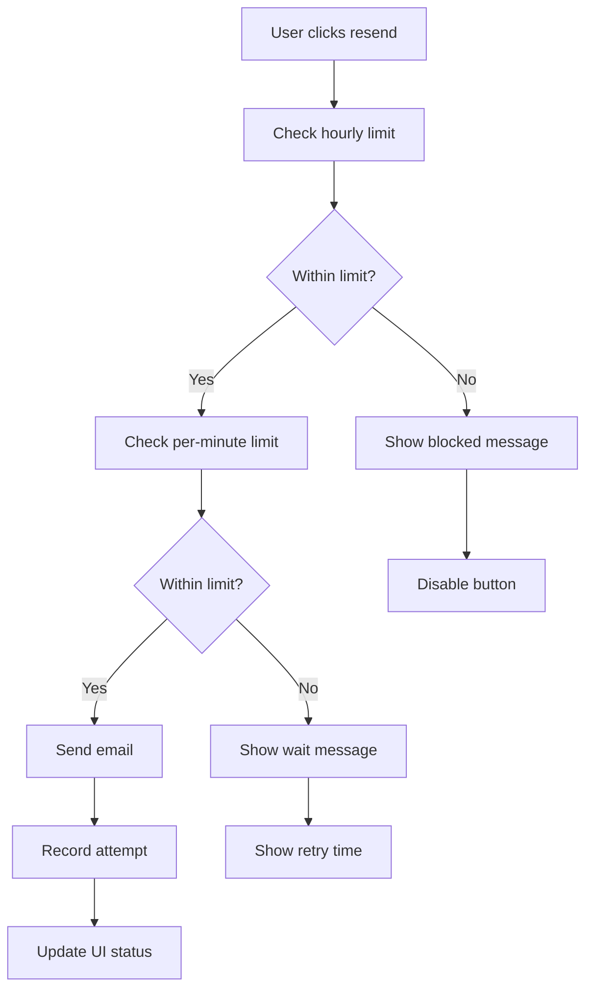

# Rate Limiting Implementation Guide

## Overview

This document describes the comprehensive rate limiting system implemented for the Xpeak AI platform, specifically focusing on email resend functionality to prevent abuse while maintaining a good user experience.

## Features Implemented

### ✅ Rate Limiting System
- **Dual-tier rate limiting**: Per-minute and hourly limits
- **Configurable limits**: Easy to adjust for different actions
- **Fail-open strategy**: System continues working if rate limiting fails
- **Automatic cleanup**: Old records are cleaned up automatically

### ✅ User Experience
- **Progressive warnings**: Users see remaining attempts
- **Clear messaging**: Exact retry times and limits
- **Graceful blocking**: Buttons disabled when rate limited
- **Automatic unblocking**: No manual intervention needed

### ✅ Security
- **Email-based tracking**: Prevents abuse while allowing legitimate use
- **RLS policies**: Secure database access
- **Configurable blocking**: Different block durations for different actions

## Rate Limit Configuration

### Email Resend Limits
```typescript
emailResend: {
  maxAttempts: 5,           // 5 resends per hour
  windowMs: 60 * 60 * 1000, // 1 hour window
  blockDurationMs: 15 * 60 * 1000, // 15 minutes block
},
emailResendPerMinute: {
  maxAttempts: 1,           // 1 resend per minute
  windowMs: 60 * 1000,      // 1 minute window
}
```

### Other Actions (Ready for Future Use)
```typescript
loginAttempts: {
  maxAttempts: 5,
  windowMs: 15 * 60 * 1000, // 15 minutes
  blockDurationMs: 30 * 60 * 1000, // 30 minutes block
},
signupAttempts: {
  maxAttempts: 3,
  windowMs: 60 * 60 * 1000, // 1 hour
  blockDurationMs: 60 * 60 * 1000, // 1 hour block
}
```

## Database Schema

### Rate Limit Table
```sql
CREATE TABLE rate_limit_attempts (
  id UUID DEFAULT gen_random_uuid() PRIMARY KEY,
  identifier TEXT NOT NULL,           -- email or user_id
  action TEXT NOT NULL,               -- 'email_resend', 'login_attempt', etc.
  timestamp TIMESTAMPTZ DEFAULT NOW() NOT NULL,
  blocked_until TIMESTAMPTZ NULL,     -- when the user is blocked until
  created_at TIMESTAMPTZ DEFAULT NOW() NOT NULL
);
```

### Indexes for Performance
```sql
CREATE INDEX idx_rate_limit_identifier_action ON rate_limit_attempts(identifier, action);
CREATE INDEX idx_rate_limit_timestamp ON rate_limit_attempts(timestamp);
CREATE INDEX idx_rate_limit_blocked_until ON rate_limit_attempts(blocked_until);
```

## Implementation Details

### 1. Rate Limiter Class (`lib/rateLimiter.ts`)

**Key Methods:**
- `checkRateLimit()`: Check if action is allowed
- `recordAttempt()`: Log successful or blocked attempts
- `getRateLimitStatus()`: Get current status for UI display
- `clearRateLimit()`: Admin function to clear limits

**Features:**
- Singleton pattern for consistent state
- Fail-open strategy (allows action if rate limiting fails)
- Configurable limits per action type
- Automatic blocking with timeout

### 2. UI Integration

**Components Updated:**
- `EmailVerificationBanner`: Shows rate limit status globally
- `VerifyEmailPage`: Rate limiting on verification page
- `LoginForm`: Rate limiting for unverified email resends

**User Experience:**
- Real-time status updates
- Progressive warnings (2 or fewer attempts remaining)
- Clear blocking messages with retry times
- Disabled buttons when rate limited

### 3. Rate Limit Flow



## Testing

### Automated Tests
```bash
npm run test:rate-limiting
```

**Test Coverage:**
- ✅ Initial resends work normally
- ✅ Rate limiting prevents abuse
- ✅ Clear messaging for users
- ✅ Button disabled when rate limited
- ✅ Rate limiting works across all pages
- ✅ Per-minute and hourly limits enforced
- ✅ User-friendly error messages

### Manual Testing Scenarios

1. **Normal Usage**: Send 1-2 emails, should work fine
2. **Approaching Limit**: Send 4 emails, should see warning
3. **Limit Exceeded**: Send 6th email, should be blocked
4. **Block Duration**: Wait 15 minutes, should be unblocked
5. **Per-Minute Limit**: Try to send 2 emails within 1 minute

## Monitoring and Administration

### View Rate Limit Data
```sql
-- Recent attempts
SELECT * FROM rate_limit_attempts 
ORDER BY timestamp DESC LIMIT 20;

-- Currently blocked users
SELECT identifier, action, blocked_until 
FROM rate_limit_attempts 
WHERE blocked_until > NOW();

-- Rate limit statistics
SELECT 
  action,
  COUNT(*) as total_attempts,
  COUNT(CASE WHEN blocked_until IS NOT NULL THEN 1 END) as blocked_attempts
FROM rate_limit_attempts 
WHERE timestamp > NOW() - INTERVAL '24 hours'
GROUP BY action;
```

### Admin Actions
```sql
-- Clear rate limits for specific email
DELETE FROM rate_limit_attempts WHERE identifier = 'test@example.com';

-- Clear all rate limits (use with caution)
DELETE FROM rate_limit_attempts;
```

## Security Considerations

### 1. Fail-Open Strategy
- If rate limiting fails, the system allows the action
- Prevents legitimate users from being blocked due to system issues
- Logs errors for monitoring

### 2. Identifier Protection
- Rate limits are tied to email addresses
- Prevents abuse while allowing legitimate use
- Can be extended to include IP addresses in the future

### 3. Configurable Limits
- Limits can be easily adjusted in the code
- Different limits for different actions
- Environment-specific configurations possible

### 4. Automatic Cleanup
- Old rate limit records are automatically cleaned up
- Prevents database bloat
- Configurable retention period

## Performance Considerations

### Database Optimization
- Indexes on frequently queried columns
- Efficient queries using timestamp ranges
- Automatic cleanup of old records

### Caching Strategy
- Rate limit status cached in component state
- Real-time updates when limits change
- Minimal database queries per user action

## Future Enhancements

### Potential Improvements

1. **IP-based rate limiting**
   ```typescript
   // Add IP tracking to rate limiting
   identifier: `${email}:${ipAddress}`
   ```

2. **Geographic rate limiting**
   ```typescript
   // Different limits by region
   const regionLimits = {
     'US': { maxAttempts: 5, windowMs: 3600000 },
     'EU': { maxAttempts: 3, windowMs: 3600000 },
   };
   ```

3. **Dynamic rate limiting**
   ```typescript
   // Adjust limits based on user behavior
   const userTrustScore = await getUserTrustScore(userId);
   const adjustedLimit = baseLimit * userTrustScore;
   ```

4. **Rate limit analytics dashboard**
   - Visualize rate limiting patterns
   - Identify abuse patterns
   - Monitor system health

5. **Whitelist functionality**
   ```typescript
   // Allow certain users to bypass limits
   const isWhitelisted = await checkWhitelist(userId);
   if (isWhitelisted) return { allowed: true };
   ```

## Troubleshooting

### Common Issues

1. **Rate limit not working**
   - Check if table exists: `SELECT EXISTS (SELECT FROM information_schema.tables WHERE table_name = 'rate_limit_attempts');`
   - Verify RLS policies are configured correctly
   - Check application logs for errors

2. **Users getting blocked too quickly**
   - Adjust rate limit configuration in `RATE_LIMIT_CONFIGS`
   - Monitor actual usage patterns
   - Consider user feedback

3. **Database performance issues**
   - Ensure indexes are created
   - Monitor query performance
   - Consider implementing caching

4. **RLS blocking operations**
   - Check RLS policies
   - Verify service role permissions
   - Test with different user roles

### Debug Commands

```sql
-- Check table structure
\d rate_limit_attempts

-- Check RLS status
SELECT schemaname, tablename, rowsecurity 
FROM pg_tables 
WHERE tablename = 'rate_limit_attempts';

-- Check recent attempts for debugging
SELECT * FROM rate_limit_attempts 
WHERE identifier = 'your-email@example.com' 
ORDER BY timestamp DESC;

-- Check for blocked users
SELECT identifier, action, blocked_until, timestamp
FROM rate_limit_attempts 
WHERE blocked_until > NOW()
ORDER BY blocked_until;
```

## Conclusion

The rate limiting system provides a robust, user-friendly solution for preventing email resend abuse while maintaining excellent user experience. The implementation is:

- **Secure**: Prevents abuse without blocking legitimate users
- **Scalable**: Easy to extend to other actions
- **Maintainable**: Clear code structure and documentation
- **User-friendly**: Clear messaging and progressive warnings
- **Reliable**: Fail-open strategy ensures system stability

The system is ready for production use and can be easily extended to cover additional rate limiting needs as the platform grows. 